# 🎫 Auto Ticket System — n8n IT Helpdesk Automation

ระบบเปิด/มอบหมาย/ปิด Ticket แจ้งปัญหา IT อัตโนมัติจากแชท LINE กลุ่ม โดยใช้ **n8n** + **AI (LLM ผ่าน OpenRouter)** จัดหมวดหมู่ปัญหา และเก็บข้อมูลลง **Microsoft SQL Server**

> Repo นี้ใช้นำเสนอ workflow เท่านั้น — ข้อมูลบริษัท/บุคคล ถูกแทนด้วย placeholder ทั้งหมด (เช่น `YourDatabase`, `YOUR_LINE_IT_GROUP_ID_1`, `example.com`)

## ✨ ความสามารถหลัก

- **Auto Ticket** — รับ event จาก LINE webhook แล้วแยกประเภทข้อความ (ข้อความ / รูป / สมาชิกเข้า-ออก / unsend)
- **AI Classification** — LLM วิเคราะห์ข้อความแจ้งปัญหา ระบุหมวดหมู่ หมวดย่อย และสาขา ด้วย structured output
- **Auto Assign** — เมื่อทีม IT reply ข้อความ ระบบจะมอบหมาย ticket ให้คนนั้นอัตโนมัติ
- **Auto Close** — ตรวจจับข้อความแจ้งว่าแก้ไขเสร็จ แล้วปิด ticket พร้อมส่งอีเมลสรุป
- **Schedule Summary** — สรุป ticket ค้างทุกเช้าทางอีเมล
- **Manual Ticket** — เปิด ticket ผ่านฟอร์ม n8n
- **Audit Log + Error Alert** — log ทุก action ลง SQL และแจ้ง error ไป Telegram

## 🧰 Stack

n8n · LINE Messaging API · OpenRouter (LLM) · Microsoft SQL Server · SMTP / Microsoft Graph · Telegram

## 🖼️ Screenshots

| Main workflow (LINE webhook) | AI classification |
|---|---|
| 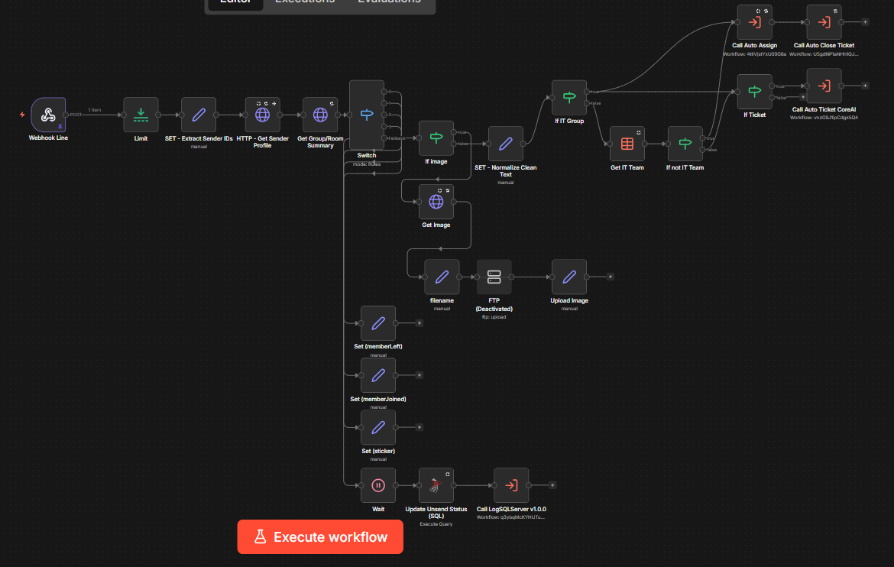 | 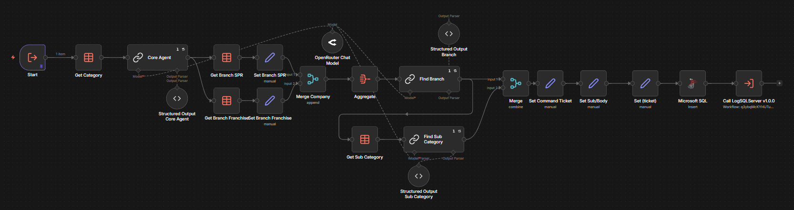 |
| **Auto Assign** | **Auto Close Ticket** |
| 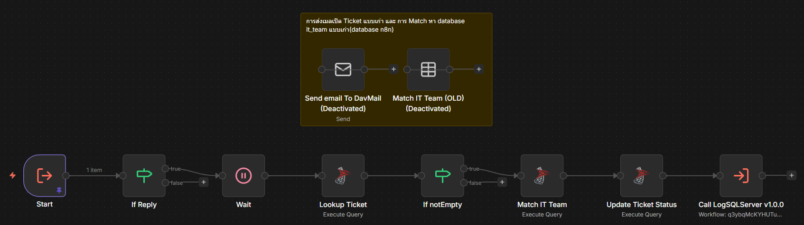 | 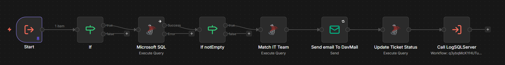 |
| **Schedule Ticket Unclose** | **LogSQLServer** |
| 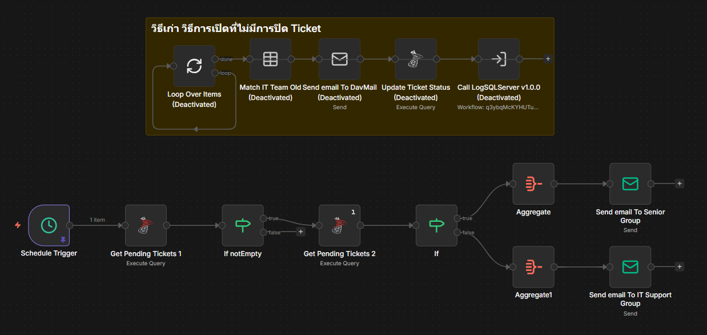 | 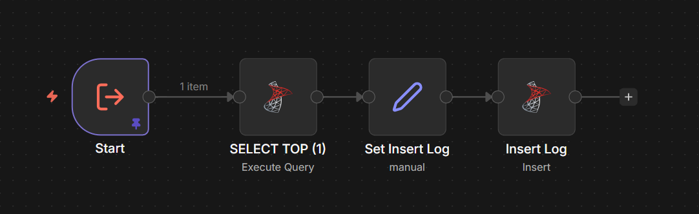 |

Architecture: [`screenshots/architecture.png`](screenshots/architecture.png) · Mermaid source: [`screenshots/architecture.mermaid`](screenshots/architecture.mermaid)

## 🧩 Workflows

ไฟล์ export ของ n8n อยู่ใน [`workflows/`](workflows/) — import ได้ผ่าน n8n (**Workflows → Import from File**) แล้วตั้งค่า credentials ของตัวเอง

### ภาพรวมการเชื่อมต่อระหว่าง Workflow

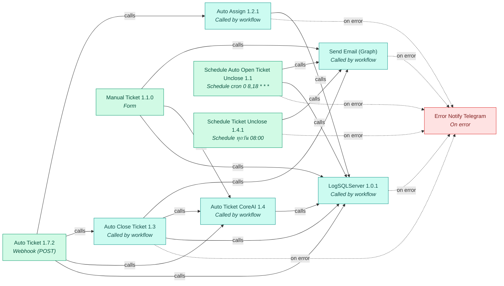

🟩 จุดเริ่ม (Webhook / Form / Schedule) · 🟦 Sub-workflow ที่ถูกเรียกใช้ · 🟥 ตัวจัดการ Error → Telegram

| Workflow | Trigger | Nodes | ระบบที่เชื่อมต่อ |
|---|---|---:|---|
| [Auto Assign 1.2.1](#auto-assign-121) | Called by workflow | 10 | MS SQL |
| [Auto Close Ticket 1.3](#auto-close-ticket-13) | Called by workflow | 11 | MS SQL |
| [Auto Ticket 1.7.2](#auto-ticket-172) | Webhook (POST) | 25 | HTTP Request, MS SQL |
| [Auto Ticket CoreAI 1.4](#auto-ticket-coreai-14) | Called by workflow | 25 | Output Parser, MS SQL, LLM Chain, OpenRouter |
| [Error Notify Telegram](#error-notify-telegram) | On error | 4 | Telegram |
| [LogSQLServer 1.0.1](#logsqlserver-101) | Called by workflow | 4 | MS SQL |
| [Manual Ticket 1.1.0](#manual-ticket-110) | Form | 19 | Form, MS SQL |
| [Schedule Auto Open Ticket Unclose 1.1](#schedule-auto-open-ticket-unclose-11) | Schedule cron `0 8,18 * * *` | 13 | MS SQL |
| [Schedule Ticket Unclose 1.4.1](#schedule-ticket-unclose-141) | Schedule ทุกวัน 08:00 | 16 | MS SQL |
| [Send Email (Graph)](#send-email-graph) | Called by workflow | 4 | HTTP Request |

### รายละเอียดแต่ละ Workflow

#### Auto Assign 1.2.1

**Trigger:** Called by workflow · **ไฟล์:** [`Auto Assign 1.2.1.json`](workflows/Auto%20Assign%201.2.1.json)

ดู Flow

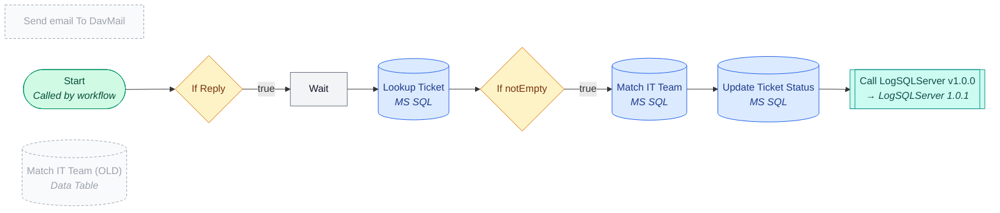

#### Auto Close Ticket 1.3

**Trigger:** Called by workflow · **ไฟล์:** [`Auto Close Ticket 1.3.json`](workflows/Auto%20Close%20Ticket%201.3.json)

ดู Flow

```mermaid
flowchart LR
  n0{"If"}
  class n0 k_branch
  n1[("Microsoft SQL<br/><i>MS SQL</i>")]
  class n1 k_data
  n2{"If notEmpty"}
  class n2 k_branch
  n3["Send email To DavMail"]
  class n3 k_disabled
  n4[("Update Ticket Status<br/><i>MS SQL</i>")]
  class n4 k_data
  n5[["Call LogSQLServer<br/><i>→ LogSQLServer 1.0.1</i>"]]
  class n5 k_call
  n6(["Start<br/><i>Called by workflow</i>"])
  class n6 k_trigger
  n7[("Match IT Team<br/><i>MS SQL</i>")]
  class n7 k_data
  n8[["Call Auto Ticket CoreAI<br/><i>→ Auto Ticket CoreAI 1.4</i>"]]
  class n8 k_call
  n9[("Find Ticket<br/><i>MS SQL</i>")]
  class n9 k_data
  n10[["Send email via Graph<br/><i>→ Send Email (Graph)</i>"]]
  class n10 k_call
  n0 -->|"true"| n1
  n1 --> n2
  n2 -->|"true"| n7
  n4 --> n5
  n6 --> n0
  n7 --> n8
  n7 --> n9
  n8 --> n9
  n9 --> n10
  n10 --> n4
  classDef k_branch fill:#fef3c7,stroke:#d97706,color:#78350f
  classDef k_call fill:#ccfbf1,stroke:#0d9488,color:#134e4a
  classDef k_data fill:#dbeafe,stroke:#2563eb,color:#1e3a8a
  classDef k_disabled fill:#f9fafb,stroke:#9ca3af,color:#9ca3af,stroke-dasharray:4 3
  classDef k_trigger fill:#d1fae5,stroke:#059669,color:#064e3b
```

#### Auto Ticket 1.7.2

**Trigger:** Webhook (POST) · **ไฟล์:** [`Auto Ticket 1.7.2.json`](workflows/Auto%20Ticket%201.7.2.json)

ดู Flow

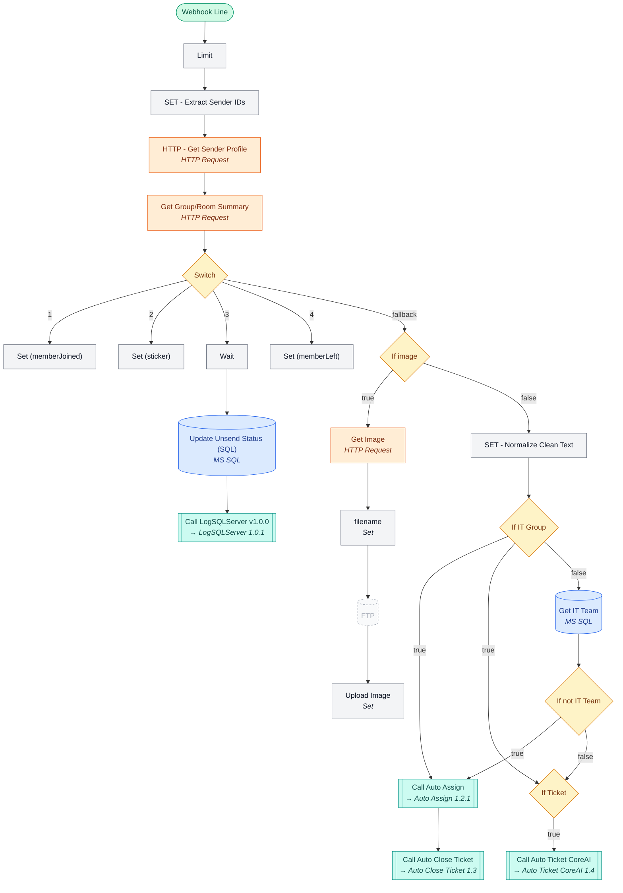

#### Auto Ticket CoreAI 1.4

**Trigger:** Called by workflow · **ไฟล์:** [`Auto Ticket CoreAI 1.4.json`](workflows/Auto%20Ticket%20CoreAI%201.4.json)

ดู Flow

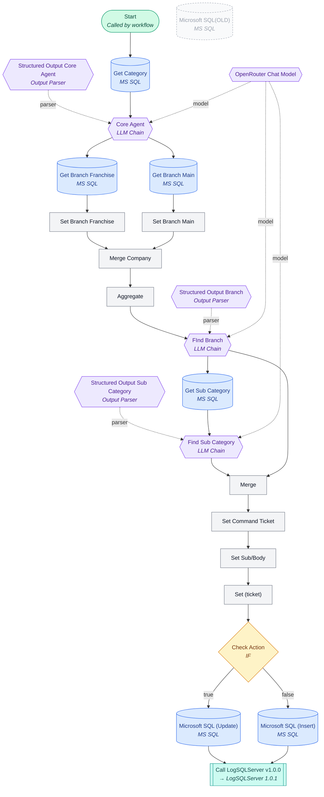

#### Error Notify Telegram

**Trigger:** On error · **ไฟล์:** [`Error Notify Telegram.json`](workflows/Error%20Notify%20Telegram.json)

ดู Flow

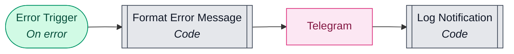

#### LogSQLServer 1.0.1

**Trigger:** Called by workflow · **ไฟล์:** [`LogSQLServer 1.0.1.json`](workflows/LogSQLServer%201.0.1.json)

ดู Flow

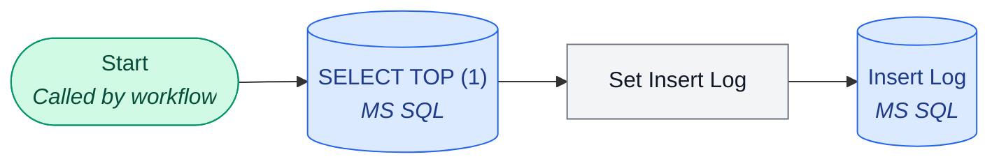

#### Manual Ticket 1.1.0

**Trigger:** Form · **ไฟล์:** [`Manual Ticket 1.1.0.json`](workflows/Manual%20Ticket%201.1.0.json)

ดู Flow

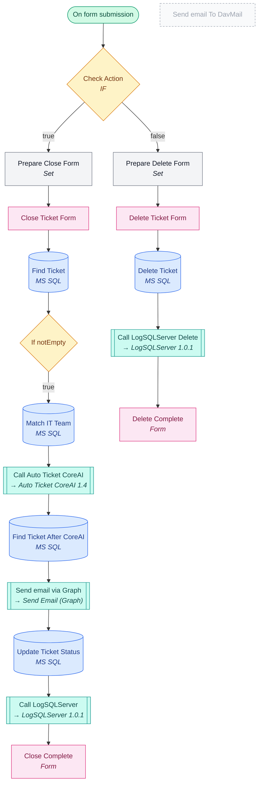

#### Schedule Auto Open Ticket Unclose 1.1

**Trigger:** Schedule cron `0 8,18 * * *` · **ไฟล์:** [`Schedule Auto Open Ticket Unclose 1.1.json`](workflows/Schedule%20Auto%20Open%20Ticket%20Unclose%201.1.json)

ดู Flow

```mermaid
flowchart LR
  n0["Send email To DavMail"]
  class n0 k_disabled
  n1["Loop Over Items"]
  class n1 k_flow
  n2[("Update Ticket Status<br/><i>MS SQL</i>")]
  class n2 k_data
  n3[["Call LogSQLServer v1.0.0<br/><i>→ LogSQLServer 1.0.1</i>"]]
  class n3 k_call
  n4{"If notEmpty"}
  class n4 k_branch
  n5{"If2"}
  class n5 k_branch
  n6[("Match IT Team<br/><i>MS SQL</i>")]
  class n6 k_data
  n7["No Operation, do nothing<br/><i>No-op</i>"]
  class n7 k_flow
  n8[("Get Pending Tickets<br/><i>MS SQL</i>")]
  class n8 k_data
  n9(["Schedule Trigger"])
  class n9 k_trigger
  n10[["Check Last Day of Month<br/><i>Code</i>"]]
  class n10 k_code
  n11{"If Last Day"}
  class n11 k_branch
  n12[["Send email via Graph<br/><i>→ Send Email (Graph)</i>"]]
  class n12 k_call
  n1 -->|"done"| n6
  n1 -->|"loop"| n1
  n2 --> n3
  n4 -->|"true"| n1
  n5 -->|"true"| n7
  n5 -->|"false"| n12
  n6 --> n5
  n8 --> n4
  n9 --> n10
  n10 --> n11
  n11 -->|"true"| n8
  n12 --> n2
  classDef k_branch fill:#fef3c7,stroke:#d97706,color:#78350f
  classDef k_call fill:#ccfbf1,stroke:#0d9488,color:#134e4a
  classDef k_code fill:#e5e7eb,stroke:#374151,color:#111827
  classDef k_data fill:#dbeafe,stroke:#2563eb,color:#1e3a8a
  classDef k_disabled fill:#f9fafb,stroke:#9ca3af,color:#9ca3af,stroke-dasharray:4 3
  classDef k_flow fill:#f3f4f6,stroke:#6b7280,color:#111827
  classDef k_trigger fill:#d1fae5,stroke:#059669,color:#064e3b
```

#### Schedule Ticket Unclose 1.4.1

**Trigger:** Schedule ทุกวัน 08:00 · **ไฟล์:** [`Schedule Ticket Unclose 1.4.1.json`](workflows/Schedule%20Ticket%20Unclose%201.4.1.json)

ดู Flow

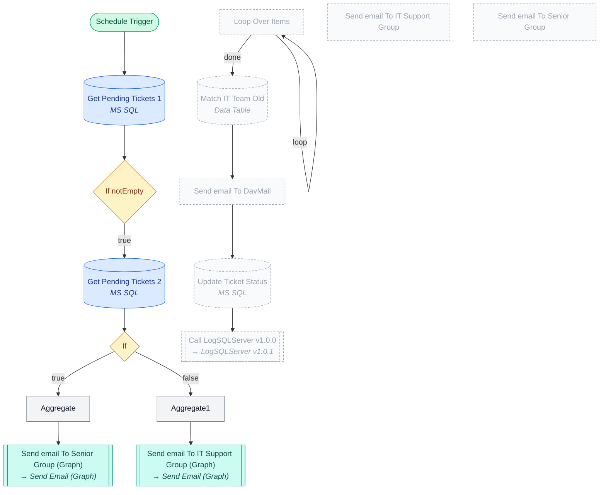

#### Send Email (Graph)

**Trigger:** Called by workflow · **ไฟล์:** [`Send Email (Graph).json`](workflows/Send%20Email%20(Graph).json)

ดู Flow

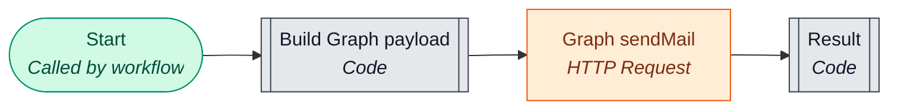

